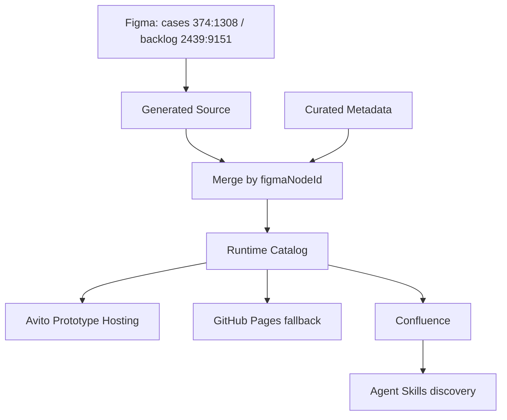

# ADT AI Tools: architecture

## Ownership

| Data | Authoritative location |
|---|---|
| Membership, title, text, links, section, authors, audience, visible status badges | Live Figma; cases `374:1308`, ideas `2439:9151` |
| Validated Figma state (two arrays, one atomic file) | `src/data/figmaCasesSnapshot.ts`, generated by sync only |
| Descriptions, categories, product type, how-to, URL-bound CTA overrides | `src/data/curatedTools.ts`, optional object keyed by `figmaNodeId` |
| Agent intents, boundaries, prerequisites, execution routing, examples | `src/data/agentSkills.ts`, editorial discovery instructions |
| Destination page IDs | `scripts/confluence/pages.json`; never catalog membership |
| Rendered knowledge | Existing Confluence AI × Design Team hierarchy; original capability instructions remain linked |

`figmaNodeId` is the only identity. Case numbers are display text. A row can have multiple statuses; working means `sourceStatusValues.includes('На проде')`. Hidden ancestors/variants are ignored. Empty status is allowed. Unknown audience/status, incomplete columns, invalid links and disappeared IDs block sync.

## Acceptance and movement

A normal new complete row requires one acceptance operation (`npm run sync:figma -- --accept-new` or manual Actions dispatch with `accept_new=true`), then ordinary PR/validation. There is no ID registry or extra-card list. Runtime drafts contain no fabricated editorial fields.

Cross-frame moves require a reviewed `--accept-moves` operation. Both source frames must be fetched. Missing IDs across both frames remain blocked even with acceptance. Cases and ideas are serialized into the same atomic file, so a move cannot leave half a source update. Curated metadata is preserved for backlog IDs; legacy route IDs are retained for future return to the catalog.

On 2026-11-03 seven existing case IDs were verified live under Backlog / Ideas and their movement was explicitly approved by the user. The existing thirteen ideas were also parsed live, eliminating the former hand-maintained ideas source.

## Execution and publication boundaries

Figma sync runs on GitHub-hosted `ubuntu-latest`, daily at 17:05 Europe/Moscow and on manual dispatch. The Mac is not its scheduler or runner. Cloud auth uses the existing repository secret `FIGMA_TOKEN`. Actual run times can be delayed by GitHub.

- No changes: successful parse/report; no source commit and no deploy.
- Safe differences: validate both frames → atomic snapshot → regression/parity/build/E2E → whitelist one generated file → one commit → validation status → bot PR/merge → fallback deployment → remote QA.
- Structural failure: snapshot and production preserved, diagnostics artifact retained.
- Concurrent source pushes cannot overwrite a newer main: ordinary non-force push rejects divergent history. Only one sync workflow runs at a time.

Prototype Hosting hosts static files; it is not a cron runner. Build with `VITE_BASE=./`; use hash routes. GitHub Pages uses `/adt-ai-tools/` plus `404.html`. Verify a deployed URL separately from a local build.

Confluence publisher uses a runner-provided corporate MCP transport (`ADT_MCP_COMMAND`, JSON argv). It checks optimistic versions, updates only managed sections, reads back fingerprints and skips unchanged content. A page ID is saved immediately after creation; on restart it also searches the exact title under the expected ancestor before creating. API creation has no distributed exactly-once guarantee; do not run concurrent publishers. Manual sections/comments stay outside managed sections.

## Internal migration gate

Avito uses Bitbucket Server / Stash. A Bitbucket Cloud `bitbucket-pipelines.yml` is not assumed to be supported. Internal frontend CI documentation describes TeamCity configuration and successful-build merge checks. Runner-independent npm scripts are ready for that CI; onboarding requires a destination project, repository permissions and an approved non-interactive publication identity.

GitHub remains canonical until Stash clone → branch → PR → green checks → merge → real production deployment is proven. Do not operate two editable canonical repositories. Preserve full git history; never use force/mirror pushes against a nonempty destination without comparing it first.

Automated publication to internal Hosting/Confluence is not proven by a local OAuth-backed publisher. Only `FIGMA_TOKEN` was configured as a GitHub secret at baseline. Do not export a personal cached OAuth token into CI or claim automatic internal deployment until machine credentials/network and a real server run are verified.

## Primary documentation consulted

- [Frontend CI / Stash setup](https://docs.k.avito.ru/service-frontend-architecture-docs/tools/frontend-ci/connect-repo/)
- [Repository creation](https://docs.k.avito.ru/service-paas-docs/paas/lifecycle/create/)
- [Prototype Hosting](https://docs.k.avito.ru/service-paas-docs/genai/pages/use_cases/prototype_hosting/)
- [Hosting TDR](https://docs.k.avito.ru/service-paas-docs-internal/dev_ai/tdr/2026-Q2-prototype-hosting/)
- [Agent Skills standard](https://docs.k.avito.ru/skills-hub/concepts/agent-skills/)
- [Original Research Skills instructions](https://cf.avito.ru/spaces/RES/pages/890382644)
- [GitHub workflow schedules](https://docs.github.com/en/actions/reference/workflows-and-actions/workflow-syntax#onschedule)
